<!--
  ─────────────────────────────────────────────────────────────
  Wyhrdev123100 · profile README
  Terminal / OS-IDE theme. Every graphic in assets/ is a
  hand-written SVG (SMIL only, no JavaScript); every photo is a
  real screenshot of the project itself.
  ─────────────────────────────────────────────────────────────
-->

<p align="center">
  
</p>

<p align="center">
  
</p>

<p align="center">
  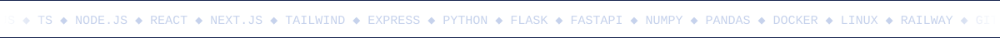
</p>

<p align="center">
  <a href="https://qhvn.vercel.app"><code>qhvn.vercel.app</code></a> ·
  <a href="https://github.com/Wyhrdev123100?tab=repositories"><code>github.com/Wyhrdev123100</code></a> ·
  <a href="mailto:qhvn@david.dev"><code>qhvn@david.dev</code></a> ·
  <a href="https://x.com/wynnaaxa8l"><code>@wynnaaxa8l</code></a> ·
  <a href="https://linkedin.com/zzzzazia"><code>linkedin</code></a>
</p>

<p align="center"></p>

<p align="center">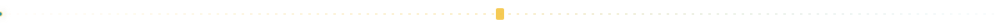</p>

## `~/about.md`

<p align="center">
  <sub>I'm Quách Hưng — a product-minded developer from Bắc Ninh, Vietnam.<br />
  I build web apps, terminal tooling and the infrastructure to ship them.<br /><br />
  <em>Tôi là Quách Hưng — lập trình viên tại Bắc Ninh. Tôi làm web app, công cụ terminal và hạ tầng để triển khai chúng.</em></sub>
</p>

<table>
  <tr>
    <td valign="top" width="50%">
      <b>What I build</b><br />
      <sub>Browser-based IDEs, real terminals over WebSocket, containerised Linux workspaces, Next.js front-ends and small Python services.</sub>
    </td>
    <td valign="top" width="50%">
      <b><em>Tôi làm gì</em></b><br />
      <sub>IDE chạy trên trình duyệt, terminal thật qua WebSocket, môi trường Linux trong Docker, giao diện Next.js và dịch vụ Python nhỏ.</sub>
    </td>
  </tr>
  <tr>
    <td valign="top">
      <b>How I work</b><br />
      <sub>Ship small, keep the repo public, write the ugly version first. Code is for the people who have to read it next.</sub>
    </td>
    <td valign="top">
      <b><em>Cách tôi làm việc</em></b><br />
      <sub>Làm bản nháp trước, mở repo công khai, rồi mới tối ưu. Code viết cho người đọc tiếp theo.</sub>
    </td>
  </tr>
</table>

<p align="center"></p>

## `~/stack.txt`

<p align="center"><sub>Everything below is used in a public repository — verified, not decorative.<br /><em>Mọi công nghệ dưới đây đều xuất hiện trong repo công khai.</em></sub></p>

<p align="center">
   JavaScript &nbsp;
   TypeScript &nbsp;
   Python &nbsp;
   HTML5 &nbsp;
   CSS3
</p>

<p align="center">
   Node.js &nbsp;
   Express &nbsp;
   React &nbsp;
   Next.js &nbsp;
   Tailwind
</p>

<p align="center">
   Flask &nbsp;
   FastAPI &nbsp;
   Django &nbsp;
   NumPy &nbsp;
   pandas &nbsp;
   scikit-learn
</p>

<p align="center">
   Docker &nbsp;
   Railway &nbsp;
   Linux &nbsp;
   Git &nbsp;
   VS Code
</p>

<p align="center"><sub>also in the box: <b>ws</b> WebSockets · <b>node-pty</b> · <b>express-session</b> · <b>bcryptjs</b> · <b>Nixpacks</b> · <b>Docker Compose</b> · <b>ttyd</b> · <b>supervisor</b></sub></p>

<p align="center"></p>

## `~/projects/`

<table>
  <tr>
    <td width="52%" valign="middle">
      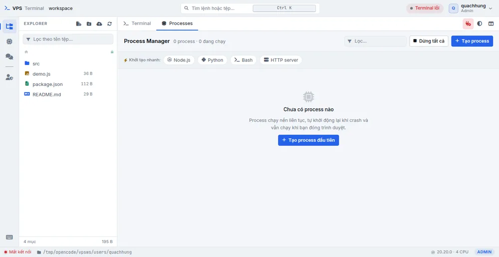
    </td>
    <td valign="middle">
      <h3 align="left"><code>~/projects/vps-terminal</code> <sub>v2.0.0</sub></h3>
      <p align="left"><b>A web IDE that runs on your VPS.</b> A real PTY terminal streamed over WebSocket, a file manager with upload / rename / download, and a background process manager that survives crashes.</p>
      <p align="left"><sub><em>Web IDE chạy trên VPS: terminal thật qua node-pty, quản lý tệp và process manager nền tự khởi động lại khi crash.</em></sub></p>
      <p align="left"><sub>Node.js · Express · ws · node-pty · express-session · bcryptjs · Docker · Nixpacks · Railway</sub></p>
      <p align="left"><a href="https://github.com/Wyhrdev123100/VPS-Terminal"><code>source →</code></a></p>
    </td>
  </tr>
</table>

<p align="center">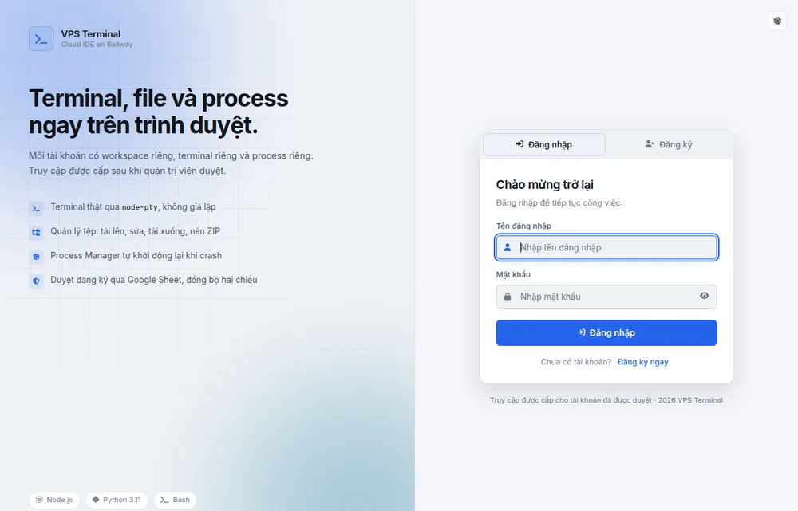</p>

<table>
  <tr>
    <td width="52%" valign="middle">
      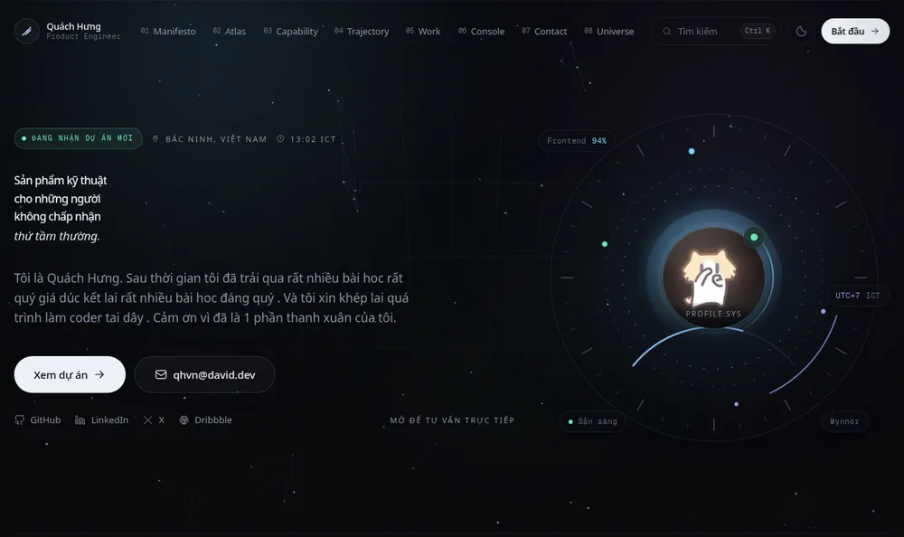
    </td>
    <td valign="middle">
      <h3 align="left"><code>~/projects/profile-wynnor</code> <sub>live</sub></h3>
      <p align="left"><b>My portfolio site.</b> A single-page experience on Next.js 15 + React 19 with TypeScript and Tailwind v4 — motion, music, an interactive atlas and a console section.</p>
      <p align="left"><sub><em>Trang portfolio cá nhân: Next.js 15 + React 19, TypeScript, Tailwind v4, có motion, nhạc, atlas tương tác và console.</em></sub></p>
      <p align="left"><sub>Next.js · React · TypeScript · Tailwind CSS · ESLint</sub></p>
      <p align="left"><a href="https://qhvn.vercel.app"><code>visit →</code></a> &nbsp; <a href="https://github.com/Wyhrdev123100/profile-Wynnor"><code>source →</code></a></p>
    </td>
  </tr>
</table>

<table>
  <tr>
    <td width="52%" valign="middle">
      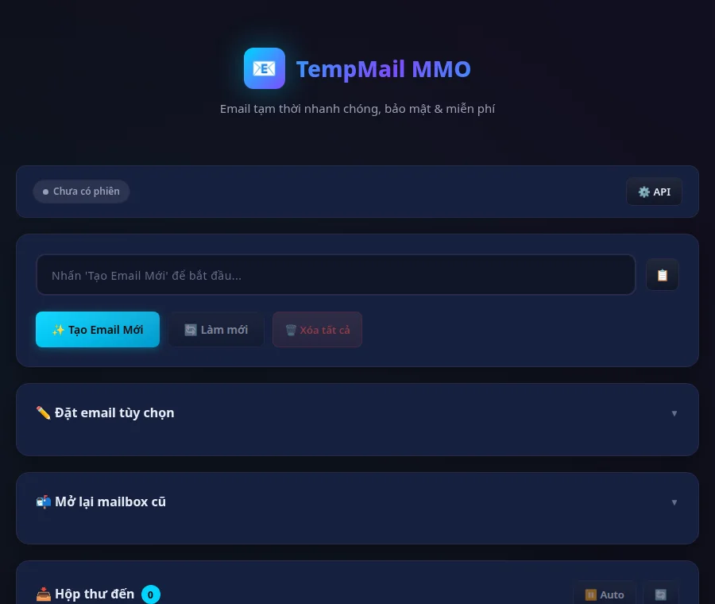
    </td>
    <td valign="middle">
      <h3 align="left"><code>~/projects/tempmail</code></h3>
      <p align="left"><b>TempMail MMO.</b> A single-file HTML tool for disposable inboxes: create a mailbox, set a custom address, auto-receive and read mail — all client-side.</p>
      <p align="left"><sub><em>Công cụ email tạm thời trong một file HTML: tạo hộp thư, đặt địa chỉ, nhận và đọc thư tự động.</em></sub></p>
      <p align="left"><sub>HTML · CSS · JavaScript</sub></p>
      <p align="left"><a href="https://github.com/Wyhrdev123100/tempmail"><code>source →</code></a></p>
    </td>
  </tr>
</table>

<table>
  <tr>
    <td width="52%" valign="middle">
      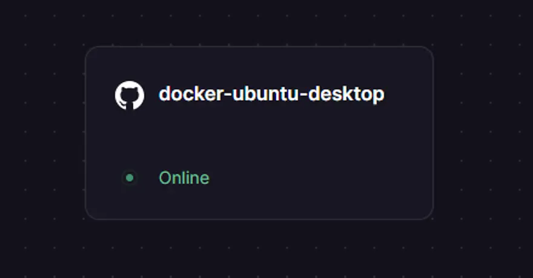
    </td>
    <td valign="middle">
      <h3 align="left"><code>~/projects/docker-ubuntu</code></h3>
      <p align="left"><b>A containerised Ubuntu 22.04 workspace on Railway</b> — ttyd web terminal, Python 3 with Flask / Django / FastAPI, the NumPy–pandas–scikit-learn stack, supervisor and cron.</p>
      <p align="left"><sub><em>Môi trường Ubuntu 22.04 đóng gói trong Docker, terminal web qua ttyd, runtime Python và bộ thư viện data.</em></sub></p>
      <p align="left"><sub>Docker · Ubuntu · ttyd · Python · supervisor</sub></p>
      <p align="left"><a href="https://github.com/Wyhrdev123100/docker-ubuntu"><code>source →</code></a></p>
    </td>
  </tr>
</table>

<details>
<summary><b><code>ls -la ~/projects/</code> — live repo index</b></summary>

```
drwxr-xr-x   profile-Wynnor    TypeScript     11.5 MB   pushed 2026-10-07
drwxr-xr-x   tempmail          HTML              17 KB   pushed 2026-08-05
drwxr-xr-x   VPS-Terminal      JavaScript       138 KB   pushed 2026-08-02
drwxr-xr-x   dsl               HTML              33 KB   pushed 2026-05-14
drwxr-xr-x   docker-ubuntu     Dockerfile         19 KB   pushed 2026-05-02
```

- **[dsl](https://github.com/Wyhrdev123100/dsl)** — `Đọa Sinh Luân`, a small Vietnamese story reader (HTML + JS).
- **[ui-ux-pro-max-skill](https://github.com/Wyhrdev123100/ui-ux-pro-max-skill)** · **[thedev.id](https://github.com/Wyhrdev123100/thedev.id)** · **[domain](https://github.com/Wyhrdev123100/domain)** · **[register (is-a.dev)](https://github.com/Wyhrdev123100/register)** · **[ua-generator](https://github.com/Wyhrdev123100/ua-generator)** · **[discord-quest-completer](https://github.com/Wyhrdev123100/discord-quest-completer)** · **[rairu-kun](https://github.com/Wyhrdev123100/rairu-kun)** — forks I keep around to read and learn from.
  <sub><em>(Một số repo là fork của dự án mở, giữ lại để học và đọc code.)</em></sub>

</details>

<p align="center"></p>

## `~/certificates/`

<p align="center"><sub>Completed October 2025. Click any certificate to open the full sheet.<br /><em>Hoàn thành tháng 10/2025.</em></sub></p>

<table>
  <tr>
    <td width="33%" align="center">
      <a href="https://huuuu.hungq64088.workers.dev/">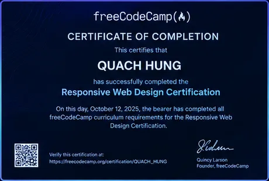</a><br />
      <sub><b>freeCodeCamp</b><br />Responsive Web Design</sub>
    </td>
    <td width="33%" align="center">
      <a href="https://huuuu.hungq64088.workers.dev/">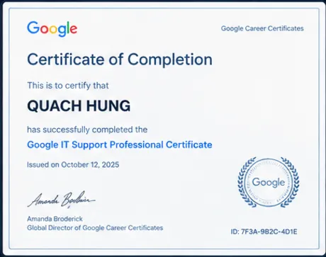</a><br />
      <sub><b>Google</b><br />IT Support Professional</sub>
    </td>
    <td width="33%" align="center">
      <a href="https://huuuu.hungq64088.workers.dev/"></a><br />
      <sub><b>Microsoft</b><br />Introduction to Azure</sub>
    </td>
  </tr>
  <tr>
    <td align="center">
      <a href="https://huuuu.hungq64088.workers.dev/">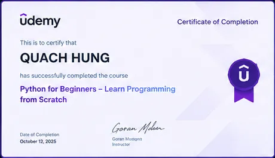</a><br />
      <sub><b>Udemy</b><br />Python for Beginners</sub>
    </td>
    <td align="center">
      <a href="https://huuuu.hungq64088.workers.dev/">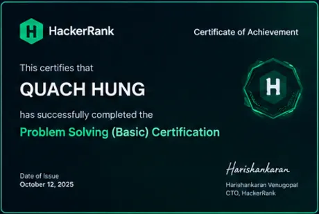</a><br />
      <sub><b>HackerRank</b><br />Problem Solving (Basic)</sub>
    </td>
    <td align="center">
      <a href="https://huuuu.hungq64088.workers.dev/">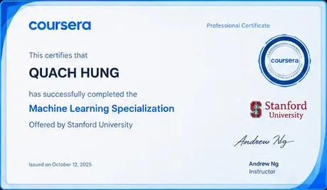</a><br />
      <sub><b>Coursera · Stanford</b><br />Machine Learning Specialization</sub>
    </td>
  </tr>
  <tr>
    <td align="center">
      <a href="https://huuuu.hungq64088.workers.dev/">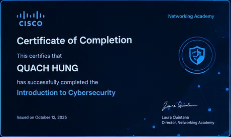</a><br />
      <sub><b>Cisco</b><br />Introduction to Cybersecurity</sub>
    </td>
    <td align="center">
      <a href="https://huuuu.hungq64088.workers.dev/"></a><br />
      <sub><b>Bộ GD&amp;ĐT</b><br />Ứng dụng CNTT cơ bản</sub>
    </td>
    <td align="center">
      <a href="https://huuuu.hungq64088.workers.dev/">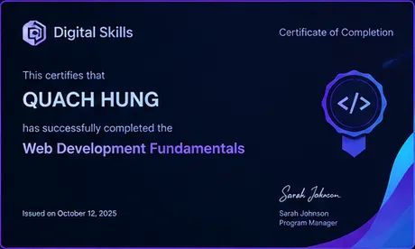</a><br />
      <sub><b>Digital Skills</b><br />Web Development Fundamentals</sub>
    </td>
  </tr>
</table>

<p align="center"></p>

## `~/stats.sh`

<table>
  <tr>
    <td width="49%" align="center">
      
    </td>
    <td width="51%" align="center">
      
    </td>
  </tr>
  <tr>
    <td width="34%" align="center">
      
    </td>
    <td width="66%" align="center">
      
    </td>
  </tr>
</table>

<p align="center"><a href="https://github.com/Wyhrdev123100"></a></p>

<p align="center"></p>

## `~/contributions.log`

<p align="center">
  <picture>
    <source media="(prefers-color-scheme: dark)" srcset="https://raw.githubusercontent.com/Wyhrdev123100/Wyhrdev123100/output/github-contribution-grid-snake-dark.svg" />
    <source media="(prefers-color-scheme: light)" srcset="https://raw.githubusercontent.com/Wyhrdev123100/Wyhrdev123100/output/github-contribution-grid-snake.svg" />
    
  </picture>
</p>

<p align="center"><sub>generated by <code>.github/workflows/snake.yml</code> — every 6 hours · eleven stars above are the same eleven in the hero</sub></p>

<p align="center"></p>

<p align="center">
  <sub>built by <a href="https://github.com/Wyhrdev123100"><b>Wyhrdev123100</b></a> · hand-written SVG, zero JavaScript<br />
  <em>Dựng tay bằng SVG, không dùng JavaScript.</em></sub>
</p>

<details>
<summary><b><code>./maintenance.sh --help</code></b></summary>

**Artwork — `assets/`**

| File | Built from | Animation |
| --- | --- | --- |
| `hero.svg` | ~1100 generated brush strokes + block-ASCII letters | 11 stars twinkling & rotating, crescent moon, spiral vortex, hillside + flickering village windows, cypress (Van Gogh, *The Starry Night*) |
| `terminal.svg` | hand-written SVG window | boot log, neofetch block, typewriter `clipPath` reveal, blinking caret |
| `ticker.svg` | seamless marquee | one-period translate loop, edge mask fade |
| `rule.svg` | dashed rule | travelling glow dots + blinking block |
| `leds.svg` | focus strip | staggered LED blink + expanding rings |
| `icons/*.svg` | brand marks, recolored to one accent | none |

- Animations use **SMIL only, no JavaScript**, so GitHub's image proxy renders them safely.
- Palette — *The Starry Night*: sky `#050A1E` / `#0A1330`, frame `#18254F`, gold `#F5C542`, chrome `#FFD866`, cream `#FFF3D6`, teal `#1D8FA8`, ultramarine `#2B4C9B`.
- The wordmark letters are plain block characters (`█` + space) in a monospace font, so they inherit whatever font the reader's browser picks — swap the `FONT` map to change the wording.
- Every stroke of the sky is generated: a swirl field (`flow()`) curls the strokes around a vortex point, the same way the brushwork in the original curves around its spiral.
- To recolour everything: edit the gradient stops in each `<defs>`.
- Swapping the wordmark text: change `WORD` in the generator — each letter is a 5×7 cell map.
- Project screenshots in `assets/projects/` are real screenshots, exported to WebP.

**Certificates — `assets/certs/`**

- One sheet, nine certificates, cropped into individual cards. To add a new one: crop from the source sheet, export WebP, add a cell to the table in `~/certificates/`.
- Every card links back to the full sheet at `https://huuuu.hungq64088.workers.dev/`.

**Snake — `.github/workflows/snake.yml`**

- Uses [`Platane/snk`](https://github.com/Platane/snk) with `github_user_name: Wyhrdev123100`, commits to the `output` branch every 6 hours, can be triggered manually with **Run workflow**.
- It writes **three** files into `output/`: the light snake, a `github-dark` snake and a cyan **neon** snake. `~/contributions.log` uses the first two; swap the `srcset` to `…-sneon.svg` if you want the neon one.
- Only `permissions: contents: write` — nothing broader.
- The snake appears **after the first successful run**; until then that section shows a broken image.
- GitHub pauses scheduled workflows after ~60 days of repo inactivity — push a commit or press **Run workflow** to restart it.

**Widgets (third-party)**

| Widget | Service | If it dies |
| --- | --- | --- |
| Stats / Top languages | `github-readme-stats` | Delete the `` |
| Streak | `github-readme-streak-stats` | Delete the `` |
| Activity graph | `github-activity-graph` | Delete the `` |
| Profile views | `komarev/ghpvc` | Delete the `<p>` |

All four were verified to return HTTP 200 when this README was written.

**Repo index**

The `ls -la ~/projects/` table is generated from the GitHub API (language, repo size in KB, last push date). Re-copy those numbers whenever you push, or delete the block — it is the only part of this README that goes stale.

**Link hygiene**

- `dribbble.com/wynnorxaut` was removed from the link bar — it currently returns 404. Re-add it when the profile is back.
- The old `qh.vercel.app` (profile bio) and `vps-terminal.vercel.app` demo were dropped for the same reason.

</details>
